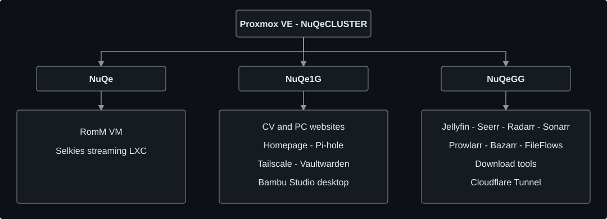

# NuQe Homelab

My homelab is where I turn an interest in IT support, hardware, and Linux into practical experience. I run a three-node Proxmox VE cluster for media services, web hosting, remote access, and everyday applications. This repository documents how the pieces fit together, what I have learned, and what still needs improving.

The cluster, `NuQeCLUSTER`, has **19 LXC containers and 2 virtual machines** across `NuQe`, `NuQe1G`, and `NuQeGG`.

## At a glance

| Node | Main role | Guests |
| --- | --- | ---: |
| `NuQe` | RomM and its streaming companion | 1 VM + 1 LXC |
| `NuQe1G` | Websites, dashboard, network utilities, and a remote desktop | 1 VM + 6 LXC |
| `NuQeGG` | Media streaming, automation, and processing | 12 LXC |

The diagram shows workload placement, rather than physical network links or every service dependency.

## Documentation

| Guide | What it covers |
| --- | --- |
| [Proxmox setup](docs/proxmox-setup.md) | Cluster roles, LXC/VM choices, and workload separation |
| [Hardware](docs/hardware.md) | Reused computers, GPU, switching, and hardware details to refresh |
| [Service inventory](docs/service-inventory.md) | All 21 current guests, their IDs, and their purposes |
| [Networking](docs/network-setup.md) | Local network, Cloudflare Tunnel, Tailscale, and public IP constraints |
| [Storage](docs/storage.md) | Storage locations, shared media, and mount paths |
| [Media stack](docs/projects/media-stack.md) | Jellyfin, media management, subtitles, and GPU processing |
| [Web hosting](docs/projects/web-services.md) | Two PHP websites hosted in separate Debian containers |
| [Dashboard](docs/projects/dashboard.md) | Homepage, Proxmox metrics, Pi-hole, and speed tests |
| [RomM](docs/projects/romm.md) | Library management and the Selkies streaming companion |
| [Remote desktop](docs/projects/remote-desktop.md) | Bambu Studio accessed from an iPad |
| [Operations](docs/operations.md) | Inventory checks, maintenance, and verification after changes |
| [Lessons and roadmap](docs/lessons-and-roadmap.md) | Practical findings and future work |

## What I practise here

- Linux administration and troubleshooting across hosts, containers, and applications.
- Choosing between lightweight LXC services and full virtual machines.
- Hosting websites with Nginx, PHP, and editable content.
- Connecting services through shared storage, API integrations, and tunnels.
- Configuring GPU access for media workloads and checking actual playback behaviour.
- Writing scripts, checking changes, and keeping useful operating notes.

## Public documentation

This repository contains architecture, service roles, and useful operating notes. Credentials, private connection details, complete application configurations, and unfiltered logs stay outside it.

[My CV website](https://cv.nuqehosting.uk/) · [My PC website](https://pc.nuqehosting.uk/) · [GitHub profile](https://github.com/NuQeGG)
